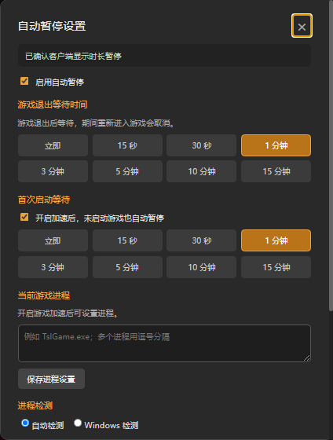
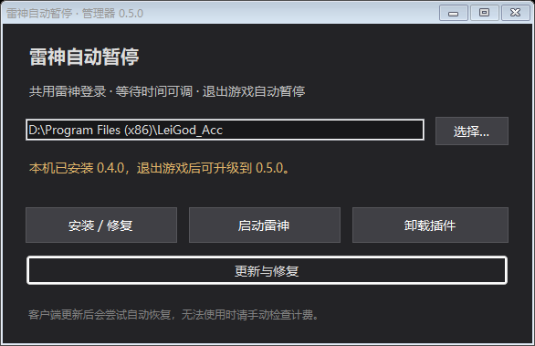

# 雷神自动暂停

**打完游戏，帮你记得暂停雷神。**

我平时玩 PUBG 会开雷神，但经常退出游戏就忘了暂停，于是做了这个工具：退出游戏后自动暂停计费，也给重开游戏留一点时间。

设置直接放在雷神窗口里，使用当前登录的账号。除了退出游戏，开了加速却一直没进游戏，也可以到时间后暂停。

## 界面

雷神顶部的入口：

搜索框右边的按钮会显示当前监控状态，点击打开设置：

以上为插件 v0.5.0、雷神 11.3.3.2 的实机截图，已裁去账号时长区域。可以分别调整游戏退出等待、首次启动等待，也可以手动设置游戏进程。

## 下载

在 [Releases](https://github.com/majorfgl/leigod-autopause/releases) 查看可用安装包。标注 **Pre-release** 的版本用于测试，日常使用请选择稳定版。

请下载 `leigod-autopause-v版本号.zip` 安装包；GitHub 的 “Source code” 是源码，不是直接运行的安装包。

## 怎么用

1. 先退出游戏和加速，完整解压安装包。
2. 打开 **雷神自动暂停.exe**，选择“安装 / 修复”，按提示允许管理员权限。
3. 以后从桌面“雷神自动暂停”入口启动。设置按钮在搜索框右边、剩余时长左边，点击后可以调整等待时间。

安装管理器预览，来自 v0.5.0 开发构建。

默认退出游戏后等 **5 分钟**，首次启动游戏等 **3 分钟**，都可以自己改。想先试试效果，可以选 15 秒，退出游戏后看看雷神是否进入暂停状态。

不想用了，打开管理器选择“卸载插件”即可，会恢复备份的模块入口并停止后台维护。更多设置和故障排查见 [使用指南](docs/usage.md)。

## 能做什么

- **退出游戏后自动暂停**：可以立即暂停，也可以留一段时间，方便重开游戏。
- **一直没进游戏也能暂停**：首次启动等待单独设置，不需要和退出等待用同一个时间。
- **重新进游戏就取消倒计时**：也可以手动暂缓这一轮等待。
- **自动识别游戏进程**：不限 PUBG；识别不到的游戏可以自己填进程名。
- **正常退出雷神时尝试先暂停**：减少退出客户端后忘记暂停的情况。
- **更新后尝试自动恢复插件**：等雷神退出再处理，不中途打断游戏。

免费和平台加速项目会跳过自动暂停。

## 雷神更新了还能用吗

会尽量自动重新适配，但不能保证每次都行。如果雷神改动比较大，仍可能需要更新工具。

v0.5.0 已在 **Windows 64 位系统上的雷神 11.3.3.2（32 位客户端）**完成 PUBG 退出、加速后未进游戏、仅开启计费三种场景的实际暂停测试，刷新后确认剩余时长不再减少。具体范围见 [兼容性与验证记录](docs/compatibility.md)。

工具支持检查稳定版更新，预发布版本需要手动下载安装。具体方式见 [更新说明](docs/updates.md)。

## 几件需要知道的事

- 这是非官方工具。它会修改雷神包外模块的加载入口，不修改官方 ASAR 和原生二进制；卸载时恢复入口。
- 判断的是游戏进程有没有运行，停在游戏大厅也算运行中。
- 强杀雷神、程序崩溃或断电时，不能保证自动暂停。关机保护还是实验功能，默认关闭。
- 不会向项目维护者上传账号、配置或日志。反馈时请遮住账号信息，数据处理方式见 [隐私说明](docs/privacy.md)。

## 反馈和参与

如果遇到没有暂停、游戏还在运行却开始倒计时，或按钮没有出现，欢迎提 [Issue](https://github.com/majorfgl/leigod-autopause/issues)。说清楚工具版本、雷神版本、游戏和复现步骤，会更方便排查。

想看代码、自己编译或提交 PR，可以从 [贡献指南](CONTRIBUTING.md) 开始。

## 致谢

感谢 [assortest/Leigod_Auto_Pause](https://github.com/assortest/Leigod_Auto_Pause)，这个项目的功能和交互参考了原插件。目前采用不同的挂载与维护方式，独立维护。

项目自身代码采用 [MIT 许可证](LICENSE.txt)，第三方材料见 [来源说明](docs/third-party.md)。本项目与雷神官方无隶属关系。
