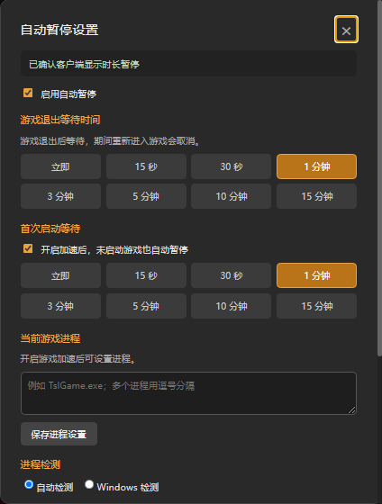

# 使用指南

## 安装与启动

在 [Releases](https://github.com/majorfgl/leigod-autopause/releases) 查看可用版本，下载 ZIP 并完整解压。预发布版本用于测试。先结束游戏与加速，再打开“雷神自动暂停.exe”选择“安装 / 修复”。安装、卸载需要管理员权限。

日常使用桌面“雷神自动暂停”入口。自动暂停按钮位于雷神顶部搜索框右侧、剩余时长左侧；点击按钮打开设置，修改后自动保存。

从 v0.5.1 起，设置面板标题旁会显示当前加载的插件版本，反馈问题时可以一并提供。

截图为插件 v0.5.0 在雷神 11.3.3.2 中的入口，已裁去账号时长区域。按钮显示内容会随监控状态变化。

## 设置等待时间

| 设置 | 什么时候生效 | 新安装默认值 |
| --- | --- | --- |
| 游戏退出等待 | 已运行过的游戏退出后 | 5 分钟 |
| 首次启动等待 | 开启加速后一直未启动游戏，或只开启计费还没有加速游戏 | 3 分钟，可单独关闭 |

插件 v0.5.0 的实际设置面板，图中展示当前设置；新安装默认值见上表。向下滚动还能看到退出保护和更新设置。

支持立即、15 秒、30 秒及多个分钟档位。首次使用可以选 15 秒验证效果：正常加速并启动游戏，再退出游戏，等待后检查账号是否暂停计费。

重新运行游戏会取消倒计时。如果只是暂时不想暂停，可以点击“暂缓本轮倒计时”；新一轮游戏或加速会话开始后恢复判断。关闭“启用自动暂停”会同时停用游戏监控、退出保护和关机保护。

## 游戏没有识别出来

1. 在雷神中开启对应游戏的加速。
2. 打开 Windows 任务管理器，在“详细信息”中找到游戏进程，例如 `TslGame.exe`。
3. 在“当前游戏进程”中填写文件名，点击保存。多个进程用逗号分隔，不要填写文件路径。

手动设置优先，留空并保存可恢复自动识别。检测依据是进程是否存在，停在游戏大厅也会算运行中。

## 进程检测和退出保护

“自动检测”优先使用客户端的检测能力，失败时尝试 Windows 检测。也可以直接选择“Windows 检测”。

“退出客户端时尝试暂停”适用于正常退出客户端；强制结束进程、崩溃和断电无法保证。关机保护为实验功能，默认关闭。

## 查看状态

| 按钮或提示 | 含义及处理 |
| --- | --- |
| 监控中 | 游戏正在运行 |
| 等待启动 / 未加速倒计时 | 还没有检测到游戏启动，等待结束后尝试暂停 |
| 游戏退出倒计时 | 游戏已退出，重新运行可取消 |
| 已暂停计费 | 客户端当前显示时长已暂停 |
| 设置进程 | 没有取得进程信息，可手动填写 |
| 暂停失败 / 状态无法确认 | 先手动检查计费，再查看设置或反馈问题 |
| 正在检查 | 尚未确认当前客户端可用，暂不自动暂停 |

免费及平台加速项目会显示跳过。更新相关问题见 [更新与修复](updates.md)。

## 卸载和反馈

结束游戏与加速后，在管理器选择“卸载插件”，恢复备份的模块入口并停止后台维护。

反馈时说明工具、雷神及 Windows 版本，使用的游戏和等待时间，并描述实际发生了什么。截图请遮住账号、联系方式和余额，不要上传完整配置目录或原始日志。
